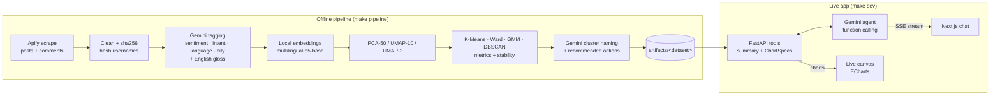

# Need Map

**Ask "What does my audience want?" and get the answer as charts, clustered from real Instagram comments on Pakistan's biggest fashion brands.**

## ▶️ Launch video (42 s)

https://github.com/user-attachments/assets/2320ffbd-9572-47ed-85dc-94dd55cf08ed

I built Need Map for the clustering module of my Big Data course. A marketer types a question in plain English or Roman Urdu. An agent picks the right clustering tool, and a live canvas fills with the needs behind thousands of comments: price asks, product-code requests, availability questions, styling praise and service complaints, each with a recommended action.

Every number on screen comes from a Python tool running over cached clustering results. The language model routes questions and explains tool output; it never calculates anything.

---

## What it answers

| Ask in chat | What you get | Method |
|---|---|---|
| *What does my audience want?* | 2-D need map, named clusters with share, mood and recommended action | K-Means (or Ward / DBSCAN / GMM) on comment embeddings |
| *Split the biggest need further* | Sunburst of sub-needs | Ward sub-clustering inside one cluster |
| *Show me the weird comments* | Unusual comments with the reason each was flagged | DBSCAN noise, distance from centroid, low GMM probability |
| *How do needs change in 12.12 vs Eid?* | Stacked bar of need share per campaign | Cluster share per group |
| *Which clustering algorithm fits best?* | Metrics table, silhouette-vs-k curves, stability | Silhouette, Davies–Bouldin, Calinski–Harabasz, bootstrap ARI |

The top bar adds one-click filters for brand, campaign and algorithm, a Real/Benchmark dataset switch, and a **Demo** button that plays all five questions in sequence.

## How it works



1. **Collect.** The Apify Instagram actors pull each brand's recent posts and their visible comments, with a budget guard that stops before the spend limit.
2. **Understand.** Gemini tags each comment (sentiment, purchase intent, language, city) in batches of 50 and writes a short English *gloss* of what the commenter wants. Roman Urdu, Urdu and English comments become comparable this way.
3. **Embed.** The glosses are embedded locally on CPU with `intfloat/multilingual-e5-base` (768-d), so there is no embedding quota.
4. **Cluster.** Four algorithms run over the same space and are scored on the same metrics. K-Means gives the primary need map; Ward provides the drill-down hierarchy; DBSCAN and GMM help find unusual comments.
5. **Name.** Gemini names each cluster from its statistics and exemplar comments, and writes one concrete action per need.
6. **Serve.** Every FastAPI tool returns `{summary, charts}`. The agent reads the summary and the frontend draws each chart by its `type`.

## Clustering methods and why K-Means

All four algorithms cluster the same embeddings: K-Means, Ward and GMM in PCA-50 space, and DBSCAN in UMAP-10 space, where density is meaningful. k is chosen per algorithm from silhouette curves and stability.

**Real dataset:**

<!-- metrics:start -->
| Algorithm | k | Silhouette ↑ | Davies–Bouldin ↓ | Calinski–Harabasz ↑ | Stability (ARI) ↑ | Noise |
|---|---:|---:|---:|---:|---:|---:|
| **K-Means** (primary) | 10 | 0.203 | 2.13 | 63.9 | 0.78 | – |
| Agglomerative (Ward) | 4 | 0.189 | 2.27 | 103.8 | 0.79 | – |
| Gaussian Mixture | 10 | 0.180 | 2.08 | 58.0 | 0.62 | – |
| DBSCAN | 13 | 0.483 (umap10) · 0.177 (pca50) | 0.42 | 2404.4 | 0.97 | 5% |

*600 comments. Stability = mean ARI across 10 resamples of 80% of the data.*
*Embedding the Gemini English gloss instead of the raw comment text: K-Means silhouette 0.203 vs 0.219 (raw).*
<!-- metrics:end -->

**Why K-Means is the primary view.** It is the most stable of the partitioning methods across resamples and its silhouette is at or near the top. It also gives a small set of balanced needs that a marketer can act on directly. DBSCAN's high silhouette comes from a different space (UMAP-10) and many small, dense groups, so the table also shows its silhouette in PCA-50 for a fair comparison. That makes DBSCAN a strong detector of unusual comments rather than a top-level need map. Ward's hierarchy powers the "split this need" drill-down.

**The needs K-Means finds in the real comments:**

<!-- clusters:start -->
| | Need | Share | Comments | Recommended action |
|---|---|---:|---:|---|
| C1 | **General Price Inquiries** | 19% | 115 | Deploy automated response bots to supply pricing instantly in the comments. |
| C2 | **General Visual Compliments** | 14% | 85 | Engage with these positive comments to boost post visibility and customer affinity. |
| C3 | **Specific Outfit Inquiries** | 12% | 73 | Provide precise product links and specific outfit details directly in reply to each query. |
| C4 | **Article Code and Link Requests** | 10% | 63 | Share direct product codes and shopping links prominently in response to inquiries. |
| C5 | **Service and Sizing Complaints** | 10% | 61 | Escalate these critical complaints immediately to customer care and quality control teams. |
| C6 | **Detailed Aesthetic Praise** | 10% | 58 | Highlight these detailed reviews in marketing materials to showcase product craftsmanship. |
| C7 | **Sale and Store Inquiries** | 9% | 52 | Publish clear sale schedules and store inventory updates across all official channels. |
| C8 | **Website Availability Complaints** | 6% | 38 | Ensure all social media posts are synchronized with live website inventory before publishing. |
| C9 | **Short Price Requests** | 5% | 28 | Automate instant direct messages supplying exact prices and buy links for short queries. |
| C10 | **Brief Praise Comments** | 4% | 27 | Respond with quick thank-you emojis to sustain social interaction and algorithm reach. |
<!-- clusters:end -->

**Benchmark accuracy.** I also built a labelled benchmark with known ground-truth needs (synthetic comments, each generated from one of ten needs) to measure how well each algorithm recovers the true structure:

<!-- benchmark:start -->
| Algorithm | k | ARI vs true need ↑ | NMI vs true need ↑ | Stability (ARI) ↑ |
|---|---:|---:|---:|---:|
| K-Means | 12 | 0.435 | 0.535 | 0.80 |
| Agglomerative (Ward) | 14 | 0.467 | 0.571 | 0.68 |
| Gaussian Mixture | 14 | 0.360 | 0.546 | 0.67 |
| DBSCAN | 49 | 0.380 | 0.546 | 0.79 |

*Labelled benchmark: 2,486 comments, each generated from one known need.*
<!-- benchmark:end -->

The tables above are generated from `artifacts/*/metrics.json` and `clusters.json`. Running `make readme` refreshes them after any pipeline run.

## Data and privacy

**Real dataset (default):** public Instagram posts and comments from seven Pakistani fashion brands: **Sapphire, Khaadi, Nishat Linen, Gul Ahmed, Agha Noor, Sana Safinaz and J.** It covers the Winter '26 collections plus each brand's recent posts, including 11.11 and festive campaigns. The data was scraped with Apify's official Instagram actors.

<!-- data:start -->
| | |
|---|---|
| Brands | 7 |
| Posts | 102 |
| Comments scraped | 863 |
| Comments clustered (after cleaning) | 600 |
| Posts dated | 12 Oct 2026 – 15 Nov 2026 |
| Scraped | 15 Nov 2026 (Apify) |

Comments per brand: Sapphire 286 · Khaadi 121 · Nishat Linen 86 · Agha Noor 47 · Gul Ahmed 43 · J. 11 · Sana Safinaz 6
<!-- data:end -->

- **Privacy by design:** usernames are replaced with a sha256 hash at ingest, and no other user fields are stored.
- **Provenance on every row:** post URL, `collected_at`, Apify actor and run ID, and an `is_synthetic` flag.
- **Cleaning:** empty, emoji-only and link-only comments are dropped, along with exact duplicates and copy-pasted repeats from the same user.
- **Coverage:** for each post, the comments are the ones Instagram shows first.
- **Benchmark dataset:** synthetic comments across 3 brands, each with a known need,, used only to measure clustering accuracy (ARI/NMI). It is always labelled *Benchmark* in the UI and is never presented as real data.

## Tech stack

| Layer | Tools |
|---|---|
| Data collection | Apify (`instagram-post-scraper`, `instagram-comment-scraper`, `instagram-profile-scraper`), `apify-client` |
| Pipeline | pandas, pyarrow, scikit-learn (K-Means, Agglomerative/Ward, GMM, DBSCAN, PCA, metrics), umap-learn |
| Embeddings | sentence-transformers, `intfloat/multilingual-e5-base` on CPU (PyTorch CPU build) |
| LLM | Google Gemini via `google-genai`: structured-output tagging and naming offline, function-calling chat agent live; disk cache and tenacity backoff |
| Backend | FastAPI, pydantic v2, Server-Sent Events |
| Frontend | Next.js (App Router, TypeScript), Tailwind, shadcn/ui, ECharts (`echarts-for-react`), framer-motion, lucide-react |
| Quality | pytest (offline, mocked LLM and embeddings), ESLint, `next build`, a sample-data pipeline smoke run |

## Setup

Everything runs inside a conda env named **`ccc`** (Python 3.12, Node 22). The Makefile refuses to run outside it.

```bash
conda activate ccc
git clone <repo-url> need-map && cd need-map

make setup      # CPU torch from https://download.pytorch.org/whl/cpu, then pip install -e "backend[dev]" and npm install
cp .env.example .env   # add GEMINI_API_KEY (and APIFY_TOKEN to scrape)
```

The first pipeline run downloads `multilingual-e5-base` (about 1 GB) once into `$CONDA_PREFIX/.cache/huggingface`.

| Command | What it does |
|---|---|
| `make scrape-dry` → `make scrape` | Real data via Apify (dry run first: 1 brand, 2 posts), with the budget guard from `config/targets.yaml` |
| `make pipeline DATASET=real` | Clean, tag, embed, cluster, name and write `artifacts/real/` |
| `make seed && make pipeline` | Build the labelled benchmark (`artifacts/synthetic/`) |
| `make dev` | Backend on :8000 and frontend on :3000; opens on the real dataset when its artifacts exist |
| `make readme` | Refresh the README metric, cluster and data tables from the artifacts |
| `make test` / `make verify` | pytest, lint and production build, plus a pipeline smoke run on `data/sample/` |

**Offline mode (no API key needed):** `MOCK_LLM=1` swaps every Gemini call for a deterministic local stand-in, and `MOCK_CHAT=1` does the same for the chat agent only. For example, `MOCK_CHAT=1 make dev` explores the shipped artifacts with no key, and `MOCK_LLM=1 make pipeline` runs the whole pipeline offline.

Model names come from the environment: `GEMINI_CHAT_MODEL` (default `gemini-3.5-flash-lite`) and `GEMINI_BATCH_MODEL`.

## Future work

- **Wider coverage:** more brands and a longer window to track how needs move from season to season (summer → Eid → winter).
- **Trend view:** schedule re-scrapes and chart each need's share week by week, with alerts when a complaint cluster grows.
- **Language-tuned embeddings:** fine-tune the embedder on Roman Urdu shopping language so the raw text clusters as well as the glosses.
- **Close the loop:** draft brand replies for the high-intent clusters (price, product code, availability) straight from the chat.
- **Cross-platform:** add TikTok and Facebook comments through the same pipeline.

---

<sub>Built by Usman for the Big Data course, clustering module.</sub>

<sub>Music: "Happy Beats / Business Moves Vol. 12" by Sascha Ende, <a href="https://ende.app/en">ende.app</a>, licensed under <a href="https://ende.app/en/standard-license">CC BY 4.0</a>.</sub>
